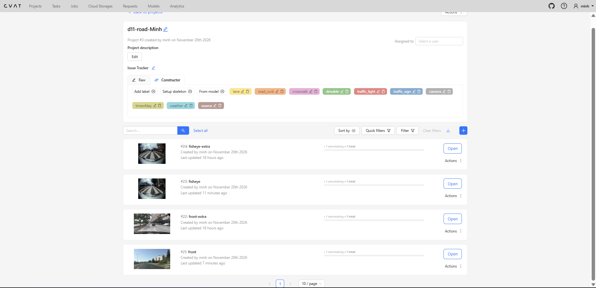
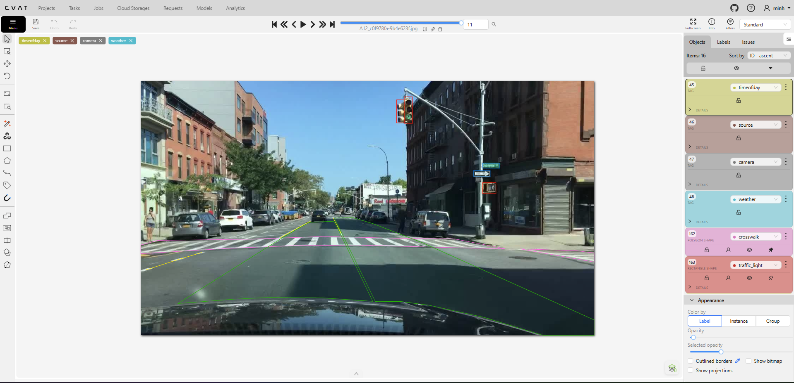
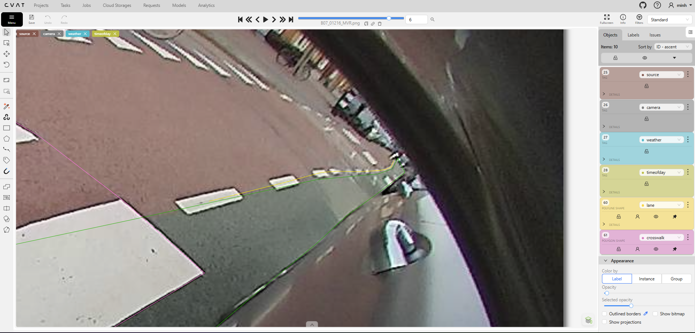
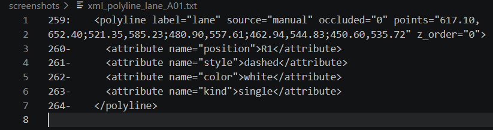

# Báo cáo cá nhân — Ngày 11
Họ tên: Nguyễn Viết Minh               Mã học viên: 2A202604043  
Phiên bản CVAT (Help → About): 2.81.0  
Guideline: Road v1.0    Lần nộp (`revision` trong manifest): 2  
Thời điểm export (ngày giờ trên CVAT): front 21/11/2026 10:10 · fisheye 21/11/2026 10:07 (giờ VN; `dumped` trong annotations.xml)    Số lần nộp lại sau Rework: 1  

## 1. Kiểm project
| Mục | Đúng như guideline Road v1.0? | Ghi chú |
| --- | --- | --- |
| 6 label, đúng kiểu | Đúng | lane, road_curb (polyline); crosswalk, drivable (polygon); traffic_light, traffic_sign (rectangle); `meta` của cả hai file export khớp `configs/road_v1_labels.json` |
| Thuộc tính và giá trị | Đúng | khớp từng giá trị; không có label lạ (lint không báo QC1-12) |
| 4 tag ảnh | Đúng | camera, timeofday, weather, source; mỗi tag một thuộc tính select `value`; 20/20 ảnh đủ bốn tag |
Cách kết thúc polyline trên bản CVAT này: nhấn phím N (hoặc double-click điểm cuối)  
Cách đặt tag ảnh trên bản CVAT này: công cụ Setup tag ở thanh trái → chọn label → bấm Tag → mở Details trong bảng Objects để chọn `value` (CVAT tự điền giá trị đầu danh sách)  

## 2. Số lượng đã gán
| Task | Ảnh | lane | road_curb | crosswalk | drivable | traffic_light | traffic_sign |
| --- | ---: | ---: | ---: | ---: | ---: | ---: | ---: |
| front | 12 | 30 | 8 | 5 | 23 | 27 | 32 |
| front-extra (đã làm 0 / 4) | 0 | 0 | 0 | 0 | 0 | 0 | 0 |
| fisheye | 8 | 9 | 4 | 7 | 4 | 6 | 6 |
| fisheye-extra (đã làm 0 / 4) | 0 | 0 | 0 | 0 | 0 | 0 | 0 |

Nguồn: `shapes_by_label` trong `nguyenvietminh-manifest.json` (revision 2). Bản nộp lần 1 (revision 1) cất ở `r1/`.

## 3. Bảng ca khó
| Ảnh | Nhãn | Phân vân giữa | Đã chọn | Lý do |
| --- | --- | --- | --- | --- |
| A04 | lane R2 (mép làn xe đạp bên phải) | một vạch đôi (`kind = double`) hay hai vạch riêng (R2 + other) | một polyline R2 `solid / white / double`, đặt giữa hai vệt sơn | hai vệt trắng chạy sát và song song như vàng đôi ở tim đường; guideline mục 3 không có quy tắc riêng cho vạch đệm làn xe đạp nên gộp theo cách vẽ vạch đôi |
| A10 | drivable | ranh giới `direct` khi gần xe không có vạch làn (dưới cầu cạn) và có gán `alternative` cho phần đường sau hàng cột không | một polygon `direct`: mép phải theo hàng cột cầu; mép trái dừng trước dãy xe đỗ; không gán `alternative` | guideline loại "vùng phía sau cọc" và dải đỗ xe khỏi `direct`; phần đường bên kia hàng cột bị cột ngăn nên không coi là làn cùng chiều bên cạnh |
| A09 | lane R1 / road_curb | vệt sáng chéo bên phải là vạch sơn đã mòn hay chỉ là mối nối mặt đường / mép bóng | không vẽ R1; mép phải vẽ `road_curb` | phóng to không thấy màu sơn trắng liên tục; lane không có thật bị tính lỗi nặng QC1-03 nên không vẽ vạch khi không chắc; mép đường là bó vỉa không sơn |

## 4. Phiếu QC 1 nhận được
Bạn kiểm lô của tôi: phamquanghuy  Quyết định nhận được: Rework (phiếu ghi lỗi chính 3 / 80 nhãn = 3,75 %, lỗi nhẹ 1)  
| Mã lỗi | Số lỗi | Đồng ý? | Đã sửa? |
| --- | ---: | --- | --- |
| QC1-06 (A04 R1 solid → dashed; B07 lane other solid → dashed) | 2 | Đồng ý | Đã sửa: cả hai lane (A04, B07) là `dashed` trong file nộp revision 2 |
| QC1-11 (B07 road_curb gập ngược) | 1 | Đồng ý | Chưa: đoạn gập vẫn còn trong file nộp revision 2 |
| QC1-01 (A07 weather clear → rain, nhẹ) | 1 | Không đồng ý: giữ `weather = overcast` theo quan sát khi gán | Không sửa |

## 5. Kiểm file export
| File | Mở lại được? | Số shape ảnh 1 (job / file) | Số shape ảnh 2 (job / file) | Tag camera có trong XML? |
| --- | --- | --- | --- | --- |
| nguyenvietminh-front.zip | Có (`road_check lint` mở được, CVAT for images 1.1) | A01: 8 / 8 | A02: 8 / 8 | Có (`camera = front`, 12/12 ảnh) |
| nguyenvietminh-fisheye.zip | Có (`road_check lint` mở được, CVAT for images 1.1) | B01: 3 / 3 | B02: 5 / 5 | Có (`fisheye_front`/`fisheye_rear`/`fisheye_left`/`fisheye_right` theo hậu tố tên ảnh, 8/8 ảnh) |

Số "job" = Items trên bảng Objects của job trừ 4 tag (A01 12, A02 12, B01 7, B02 9); số "file" đếm từ `annotations.xml` sau khi mở lại; cả bốn ảnh khớp. Cả hai zip chỉ chứa `annotations.xml`, không kèm ảnh (`contains_images = false` trong manifest).

## 6. Ảnh chụp màn hình
### 6.1. Tab Labels của project
Project có sáu label vẽ (lane, road_curb, crosswalk, drivable, traffic_light, traffic_sign) và bốn label tag (camera, timeofday, weather, source), đúng guideline Road v1.0.



### 6.2. Ảnh camera trước đã gán đủ: A12
Ảnh A12 có lane (L1, R1, L2), vùng drivable (direct và alternative), crosswalk, hộp traffic_light và traffic_sign cùng bốn tag. Job có 16 mục gồm 12 hình vẽ và 4 tag.



### 6.3. Ảnh fisheye đã gán, phóng to polyline cong: B07
Ảnh B07 (fisheye_right) có ba lane `position = other` đặt điểm theo cung, cùng crosswalk, drivable và road_curb. Job có 10 mục gồm 6 hình vẽ và 4 tag.



### 6.4. Đoạn XML có `<polyline label="lane">`
Lane R1 của ảnh A01 trong `nguyenvietminh-front.zip` (`annotations.xml`, CVAT for images 1.1): điểm đầu (617, 652) ở gần xe, các thuộc tính position, style, color, kind nằm trong từng hình.



```xml
<polyline label="lane" source="manual" occluded="0" points="617.10,652.40;521.35,585.23;480.90,557.61;462.94,544.83;450.60,535.72" z_order="0">
  <attribute name="position">R1</attribute>
  <attribute name="style">dashed</attribute>
  <attribute name="color">white</attribute>
  <attribute name="kind">single</attribute>
</polyline>
```

Nguồn ảnh trong ảnh chụp 2 và 3 (chỉ dùng cho mục đích học tập, phi thương mại): ảnh A12 thuộc BDD100K — Dữ liệu BDD100K © 2018 The Regents of the University of California, theo BDD100K License. Ảnh B07 thuộc WoodScape — © Valeo, CC BY-NC-SA 4.0 (Yogamani, S. et al., *WoodScape: A multi-task, multi-camera fisheye dataset for autonomous driving*, ICCV 2019).

## 7. Tự đánh giá
Lỗi bạn mắc nhiều nhất hôm nay (theo mã QC1-xx), và cách tránh ở Ngày 20: QC1-09 (`group` của biển báo): tôi hay không xác định được biển thuộc nhóm nào, nhất là biển Mỹ nền trắng (có thể là `prohibitory` hoặc `mandatory`) và nhiều biển còn để nguyên giá trị mặc định `prohibitory`. Ở Ngày 20 tôi sẽ đọc chữ / ký hiệu trên biển rồi tra bảng nhóm biển ở guideline mục 3 (phân theo chức năng, không theo màu hay hình dạng); với mỗi box mở Details để chọn `group` thay vì để mặc định; biển nào không chắc thì chọn nhóm gần nhất theo chức năng và ghi ngay vào bảng ca khó.  
Nhãn của bạn đi vào model ở đâu? Chọn một lỗi đã sửa và nói nó làm model học sai thế nào: nhãn `lane` (polyline và thuộc tính) là đích huấn luyện cho model phát hiện làn kiểu row-anchor và cho phần phân loại thuộc tính vạch, đầu ra của nó được LKA / hệ thống giữ làn dùng. Lỗi đã sửa: ở A04, vạch R1 là vạch đứt nhưng tôi gán `style = solid`. Nếu để nguyên, model học rằng kiểu vạch này là vạch liền, tức là "không được chuyển làn"; xe sẽ hiểu sai luật ở chỗ được phép chuyển làn, và tập dữ liệu bị lệch về phía vạch liền khi thống kê theo `style`.  

## 8. (Tùy chọn, buffer) Từ polyline đến đích row-anchor
| y | 720 | 680 | 640 | 600 | 560 |
| --- | ---: | ---: | ---: | ---: | ---: |
| x của chúng tôi | không có làn | không có làn | 599.4 | 542.4 | 484.4 |
| x của bạn kia | không có làn | không có làn | 601.6 | 543.8 | 486.2 |

Ảnh A01, vạch R1; số liệu từ `python -m road_lab.rowanchor <file>.zip --image A01 --position R1` (bạn kia: phamquanghuy).

Trả lời 3 câu:

1. Năm số x đó chính là đích mà một model row-anchor học cho vạch này. Nếu bạn dừng polyline sớm 40 px, hàng nào đổi thành "không có làn"?
2. So với bạn được kiểm (cùng ảnh): ở hàng 720 và hàng 560, hai bạn lệch nhau bao nhiêu pixel? Lệch ở hàng nào ảnh hưởng LKA nhiều hơn (slide 25)?
3. Nếu polyline vẽ từ xa về gần (ngược quy tắc 2), cách tính trên có đổi không? Script nào sẽ gặp khó?

Trả lời:

1. R1 của A01 đi từ y ≈ 652 (gần xe) lên y ≈ 536 (xa). Hàng 720 và 680 đã là "không có làn" vì nằm dưới điểm đầu. Nếu dừng sớm 40 px ở đầu xa (điểm cuối lên tới y ≈ 576 thay vì 536) thì hàng 560 đổi thành "không có làn"; nếu thiếu 40 px ở đầu gần xe (điểm đầu ở y ≈ 612) thì hàng 640 đổi thành "không có làn".
2. Hàng 720: cả hai đều "không có làn", không so được. Hàng 560: 486,2 − 484,4 = 1,8 px (trong ngưỡng 5 px). Lệch ở các hàng gần xe (y lớn) ảnh hưởng LKA nhiều hơn, vì LKA dùng vị trí vạch sát xe để tính khoảng cách ngang của xe tới vạch.
3. Năm số x không đổi: script nội suy tuyến tính giữa hai điểm kẹp mỗi hàng nên không phụ thuộc thứ tự điểm. Script gặp khó là `road_check`: `lint` và `check` coi điểm đầu là điểm gần xe nên polyline ngược bị báo QC1-04 (sai chiều) và phép so hai đầu polyline với GT bị lệch.
